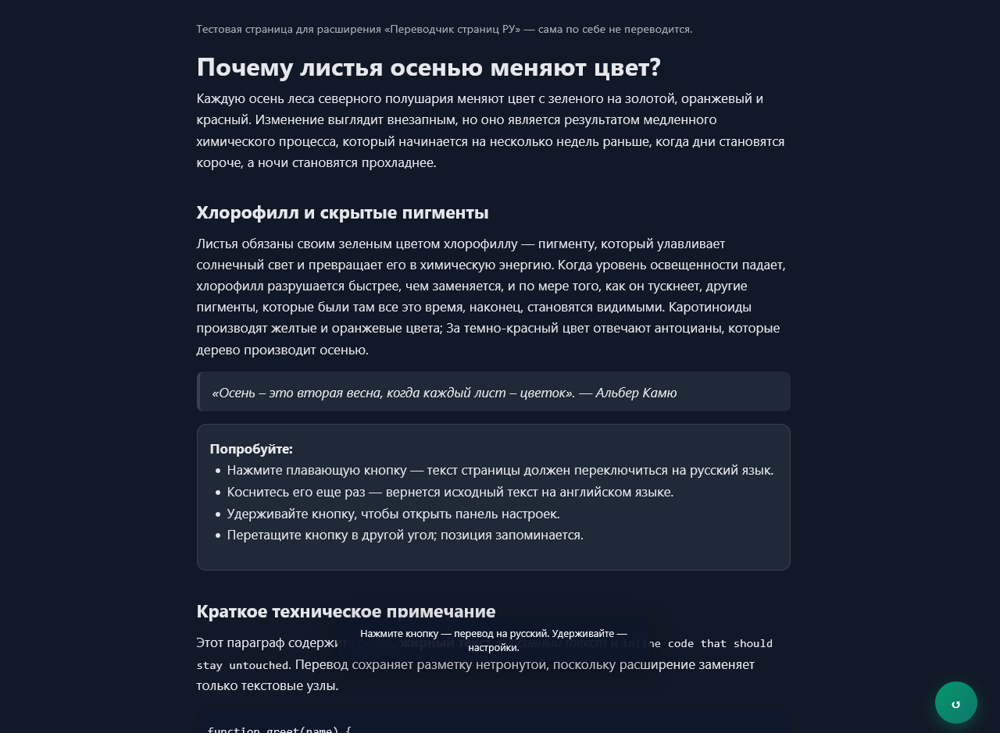

# Page Translator RU — перевод страницы на русский

Расширение для Firefox (Android и компьютер). Добавляет на каждую страницу плавающую кнопку:
одно нажатие переводит текст страницы на русский, повторное — возвращает оригинал.

[**Скачать `firefox-translate-ru.zip`**](firefox-translate-ru.zip) · [Инструкция по установке](firefox-translate-ru/README.md) · [Материалы для AMO](store/README.md)



## Возможности

- Перевод **текста страницы**, а не всей страницы: разметка, ссылки, картинки и вёрстка остаются на месте.
- Одно нажатие — перевод, второе — возврат оригинала.
- Плавающая кнопка: перетаскивается, позиция запоминается, размер меняется в настройках (40–72 px).
- При прокрутке вниз кнопка скрывается, при прокрутке вверх — возвращается (можно отключить).
- Прогресс перевода на кнопке, перевод можно прервать.
- Три сервиса: **Google** (без ключа), **DeepL** (ключ API), **LibreTranslate** (свой сервер).
- Удержание кнопки — панель настроек: сервис, языки, ключи, размер, автоповедение.
- Не переводит код, поля ввода, скрытые блоки и страницы, которые уже на русском.
- Никакой телеметрии и внешних скриптов: только запросы к выбранному сервису перевода.

## Установка

### Firefox для Android

Официальный способ — установка из подписанного `.xpi`:

1. Скачайте подписанный `.xpi` (из письма AMO / Developer Hub; если он опубликован в Releases — оттуда).
   Файл `firefox-translate-ru.zip` из этого репозитория — **неподписанный** пакет для AMO, а не для установки.
2. Перекиньте файл в «Загрузки» на телефоне.
3. Firefox → **Настройки** → **О Firefox** → пять раз нажмите на логотип Firefox.
4. **Настройки** → **«Установить расширение из файла»** → выберите `.xpi` → **Добавить**.

Нужен Firefox для Android **142+**. Как получить подписанный `.xpi` — в
[store/submission-checklist.md](store/submission-checklist.md).

### Компьютер

1. Откройте `about:debugging#/runtime/this-firefox`.
2. **«Загрузить временное дополнение…»** → выберите `firefox-translate-ru/manifest.json`.
3. Откройте [тестовую страницу](firefox-translate-ru/test/demo.html) и нажмите кнопку **RU**.

Временное дополнение живёт до перезапуска Firefox. Для постоянной установки используйте подписанный `.xpi`.

## Сборка

```bash
python tools/build_zip.py
```

Скрипт собирает `firefox-translate-ru.zip` с `manifest.json` в корне и прямыми слэшами в именах файлов
(Windows-архиватор `Compress-Archive` для AMO не подходит — он пишет `content\main.js`).

## Структура

```
firefox-translate-ru/     исходники расширения (manifest, background, content, icons, тесты)
store/                    тексты карточки AMO, политика приватности, скриншоты, иконка
tools/                    build_zip.py, selftest.js, инструкции
.github/workflows/        сборка zip в GitHub Actions
```

Подробности по коду — в [firefox-translate-ru/README.md](firefox-translate-ru/README.md).

## Тесты

```bash
node tools/selftest.js
```

Проверяет провайдеров перевода, нарезку текста и фоновый скрипт (нужен интернет для Google).
Полные браузерные тесты (Chromium/Firefox через CDP/Marionette) лежат в истории разработки и требуют
локально установленные браузеры и Windows-пути — см. [tools/README.md](tools/README.md).

## Публикация в AMO

Готовые тексты карточки, политика приватности и чек-лист — в [store/](store/README.md).
Версия 1.0.3, Manifest V2, минимум Firefox 142 (из-за `data_collection_permissions`).

## Приватность

Текст страницы отправляется только выбранному сервису перевода (Google, DeepL или ваш LibreTranslate).
Расширение не имеет собственного сервера, не собирает статистику и не использует аналитику.
Подробнее: [политика приватности](store/privacy-policy.md).

## Лицензия

MIT — см. [LICENSE](LICENSE).
